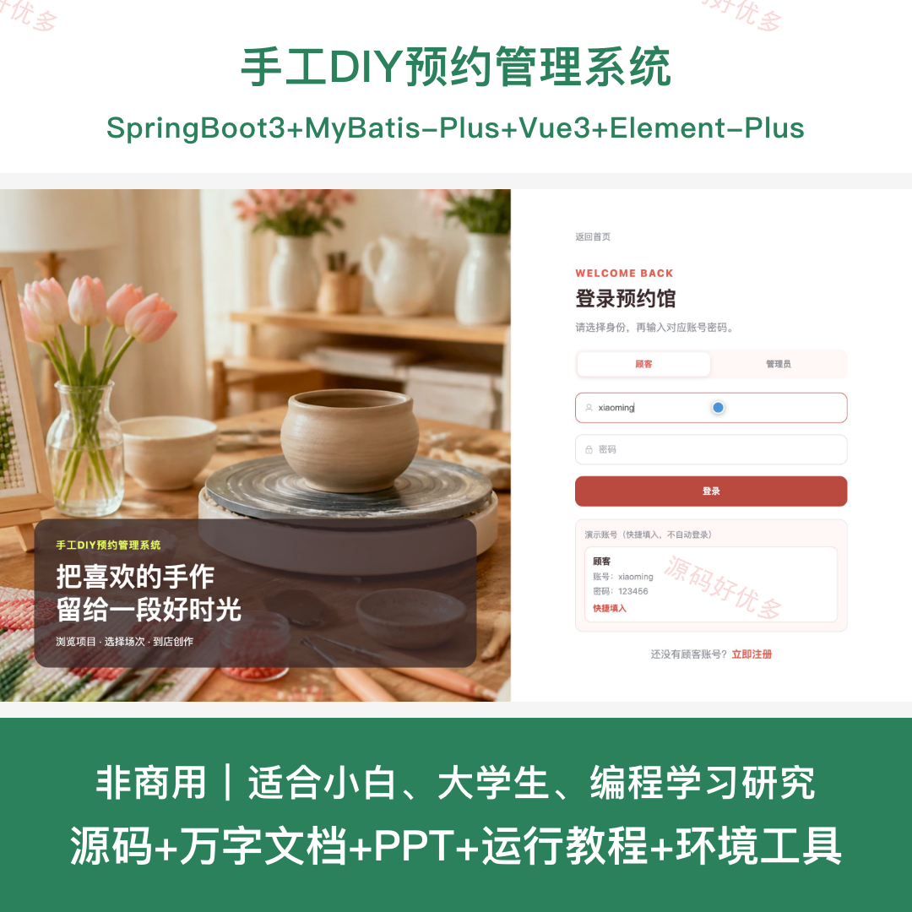
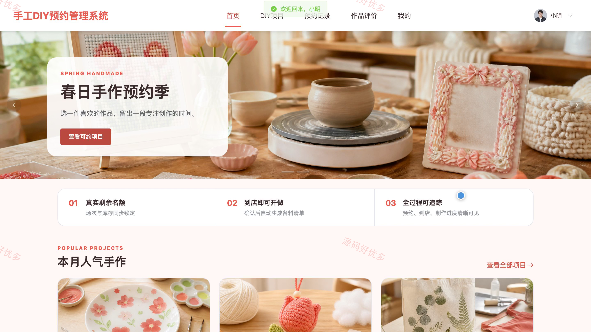
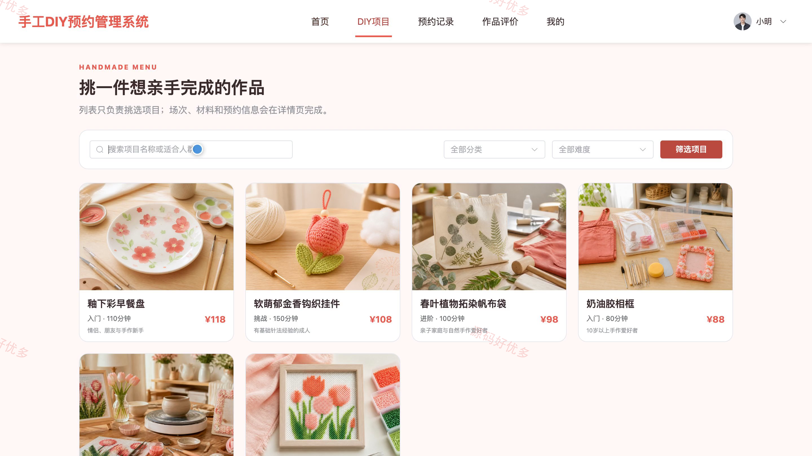
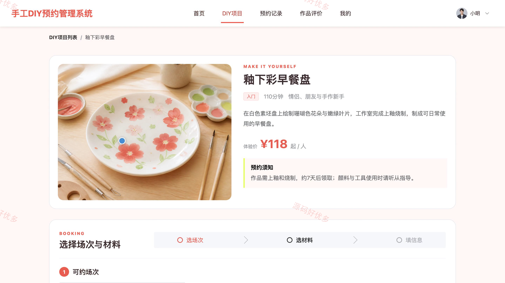
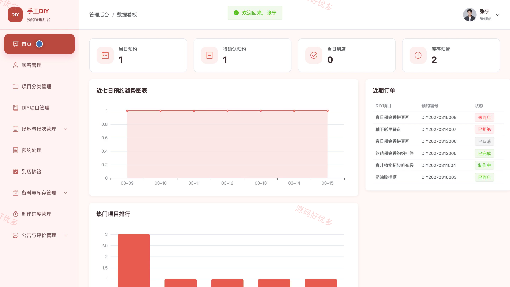
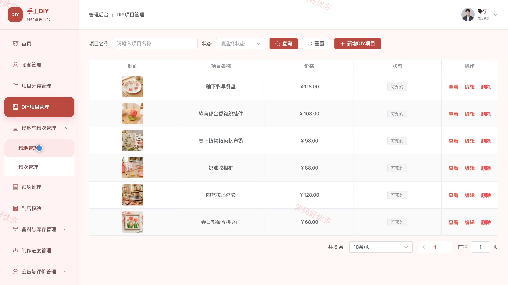
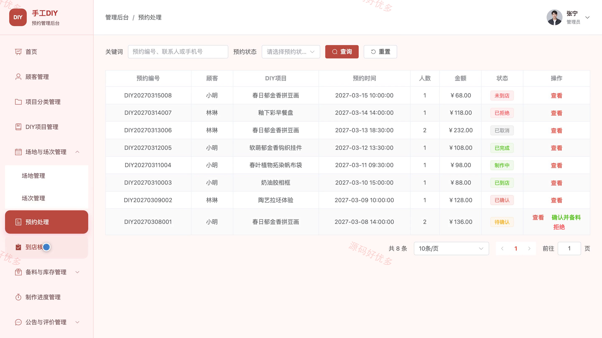
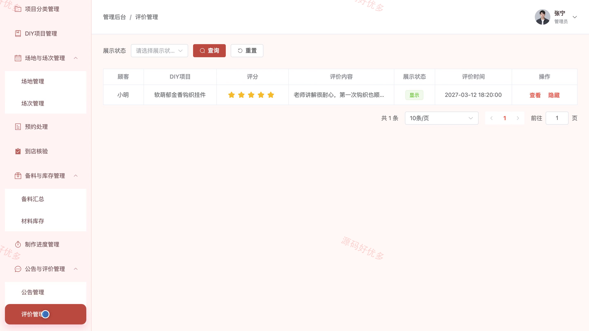

## 源码问题查看主页咨询

### 一、关键词
手工预约、DIY体验、创意工坊、手作活动、材料备料

### 二、作品包含
源码+数据库+万字设计文档+PPT+全套环境和工具资源+本地部署教程

### 三、项目技术
前端技术： Html、Css、Js、Vue3.4、Element-Plus
后端技术：Java、SpringBoot3.2.0、MyBatis-Plus

### 四、运行环境（以下版本亲测，其他版本兼容性请自行测试）
开发工具：IDEA/eclipse + VSCODE

数据库：MySQL5.7+（共12张表）

数据库管理工具：Navicat10以上版本

环境配置软件： JDK17 + Maven3.6

前端Nodejs：16+

浏览器：谷歌浏览器

### 五、项目介绍
项目编号：bs112A

面向手工 DIY 线下体验预约场景，顾客可浏览手工项目、查询可约场次、选择材料套餐并提交预约，管理员负责项目、场地、场次、预约核验、材料库存与制作进度，并统计预约量和到店情况。

角色：顾客、管理员

顾客功能：项目分类浏览、项目详情查看、可约场次查询、在线预约、预约记录、取消预约、作品与评价、个人中心。

管理员功能：数据统计、顾客管理、项目与分类管理、场地与场次管理、预约处理与到店核验、备料与库存管理、制作进度管理、公告与评价管理。

### 六、运行截图

